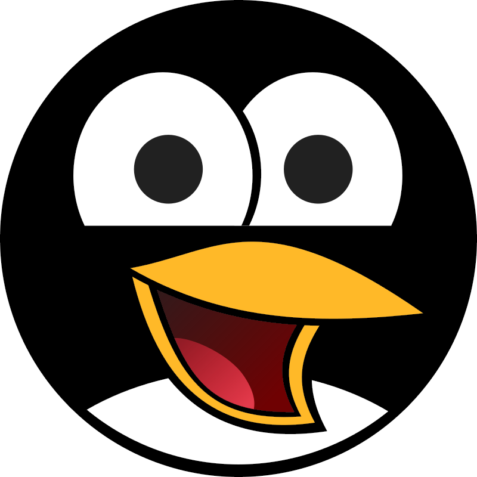

# Plugin Integration

CoolerDash runs as an unprivileged integration plugin. CoolerControl manages its
service lifecycle automatically; no separate service setup is needed.

## Authentication

Create a token with Write Access under CoolerControl's Access Protection, then
save it under Plugins > CoolerDash > Connection. CoolerDash persists the token
with restricted permissions in `credentials.json`; `config.json` only contains
the `***` sentinel after the token has been saved.

## Animated GIF Backgrounds

Select an animated GIF as the background and save. CoolerDash streams it behind
live sensor values in Split, Dual, and Circle and applies the configured fit,
opacity, and rotation. It chooses the LCD format for the detected device.

| Device | Direct stream | Frame rate limit |
|---|---|---|
| Kraken Elite V2 (`1e71:3012`) | Q565 at 640 × 640 | 12 fps |
| Kraken Base (2023, `1e71:300e`) with firmware 2.x | RGB565 at 240 × 240 | 5 fps |

For direct LCD access, connect to the local CoolerControl daemon. Reset the LCD
setting and disable that LCD channel. Keep the cooler enabled so CoolerControl
can read sensors and manage the pump and fans. The unprivileged plugin account
needs access to the LCD's USB and hidraw nodes. With the LCD channel enabled,
CoolerControl can receive a still frame with live sensors or the original GIF
on devices that support native playback with all sensor slots disabled.

The stream accepts a GIF up to 16 MiB with a canvas up to 2048×2048 and a
64 MiB decoded frame budget. CoolerDash polls sensors at most once per second.
A USB failure releases the LCD and stops the stream until
the next configuration reload or restart. The CoolerControl shutdown image
test requires an enabled LCD channel.

## Shutdown Image

Registered once at startup through CoolerControl's shutdown-image API:

```
PUT /devices/{uid}/settings/{channel}/lcd/shutdown-image
```

CoolerControl stores the image and displays it when it stops. Configure a custom
shutdown image via `paths.image_shutdown`, or keep the default file at
`/var/lib/coolercontrol/plugins/coolerdash/shutdown.png`.

The UI can import a local image into the plugin-owned directory as
`user-shutdown-image`. Each successful import atomically replaces that one file;
a failed import keeps the previous image. Images are limited to 16 MiB and 32
megapixels. The UI shows a still preview of the selected image; animated
GIFs show their first frame. Save the settings after import so CoolerDash
restarts and registers the new shutdown image. Existing custom paths remain in
the configuration until another image is selected. A path in a private home
directory may be unreadable to the plugin.

"Show on LCD for 5 seconds" sends the selected image to the physical display
without stopping CoolerControl. The normal dashboard resumes after five seconds.
This checks the image and LCD upload, but the actual CoolerControl shutdown hook
still requires a shutdown test.

CoolerDash detects PNG, GIF, JPEG, BMP, and TIFF files by content. At 0° it
sends the original file with its matching MIME type; animated GIF support then
depends on the LCD device and driver. At other angles it sends a rotated PNG
copy. For animated sources, that copy contains the first frame.



## Plugin UI

Theme-adaptive UI using CoolerControl CSS variables + Tailwind CSS + PrimeIcons.

### CSS Variables

```css
--colors-bg-one       /* Primary background */
--colors-bg-two       /* Secondary background */
--colors-border-one   /* Border color */
--colors-text         /* Text color */
--colors-accent       /* Accent color */
```

### Manifest

```toml
version = "{{VERSION}}"
privileged = false
url = "https://github.com/damachine/coolerdash"
```

Displayed on the CoolerControl plugin page.

## Settings UI Sections

- Daemon: API address, access token
- Display: Mode, refresh interval, brightness, orientation
- Advanced: Display dimensions

## Background Preview

The Display tab loads a static background thumbnail through
`pluginFetch('/background-preview?path=' + encodeURIComponent(path))` on the
existing loopback plugin data server. The path may be an unsaved form value.
The endpoint accepts absolute paths to readable regular PNG, GIF, JPEG, BMP or
TIFF files, detects the format by content and returns JSON containing a PNG data
URI. Input is limited to 16 MiB and 32 megapixels; output fits within 480 × 480
pixels. GIFs produce a still frame, independently of the device animation state.

The UI debounces path edits, ignores stale responses and applies background fit,
zoom, color and overlay settings locally. Clearing the path restores the solid
background color. The plugin executable must be running for thumbnail requests.

## Display Preview

The Display tab can send its unsaved configuration as JSON to the loopback
`POST /render-preview` endpoint. CoolerDash renders deterministic sample sensor
values with the production Cairo renderer and returns a PNG data URI. The
endpoint writes only private temporary files, does not save the configuration,
does not query live sensors and never uploads an image to the LCD. Requests are
limited to 64 KiB.

The Custom Layout editor sends only the active draft and the display settings
it needs. Its preview keeps the rendered image at the device resolution.

## System Font Selection

The Font Face field loads installed family names from Fontconfig through the
loopback `/fonts` endpoint. It remains editable so an existing or custom family
name can still be saved when discovery is unavailable. Only the selected family
name is stored in `font.face` in the plugin configuration.

## Related

- [Configuration Guide](config-guide.md)
- [Plugin UI Theming](plugin-ui-theming.md)
- [CoolerControl Custom Device Plugin](https://gitlab.com/coolercontrol/cc-plugin-custom-device)
